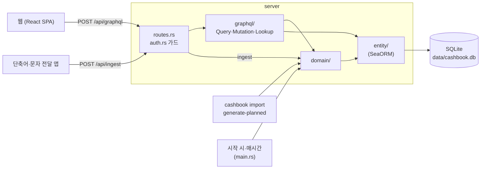
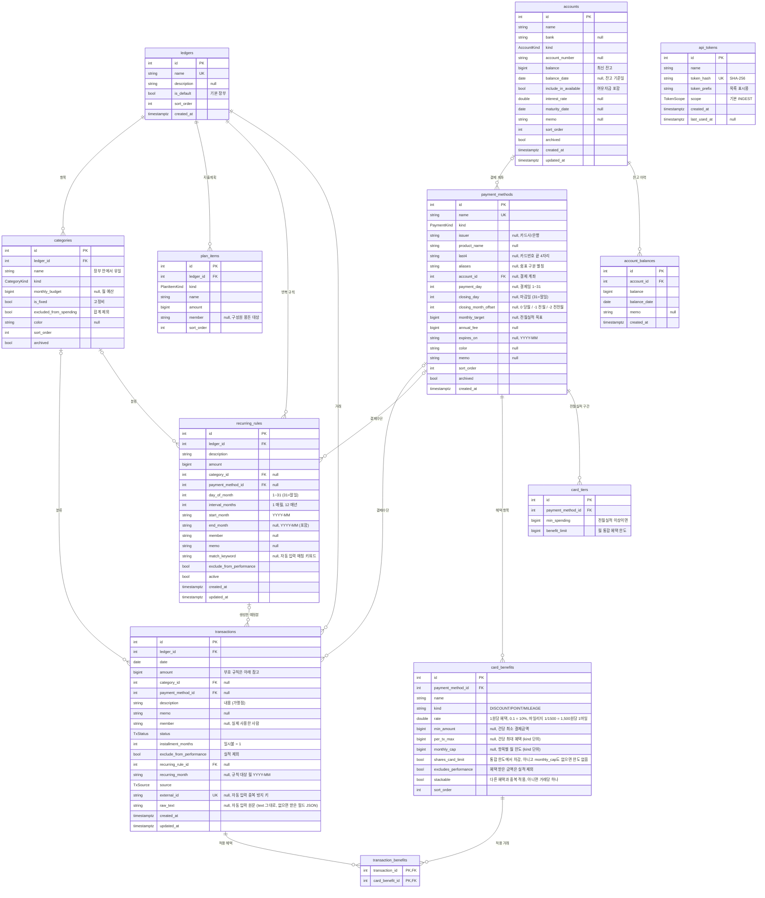

# cashbook server

가계부 백엔드. Rust 2024 · Rocket 0.5 · async-graphql 7 · SeaORM 2 · SQLite.

이 문서는 서버 코드 구조와 데이터 모델을 설명합니다. 다음 내용은 루트 README에 있습니다.

- 실행·데이터 가져오기·운영 명령: [빠른 시작](../README.md#빠른-시작)
- 환경 변수·보안 동작: [설정](../README.md#설정-환경-변수)
- 소비·정산·여유자금·혜택 계산 규칙: [핵심 계산 규칙](../README.md#핵심-계산-규칙)
- `/api/ingest` 요청 형식: [자동 입력 API](../README.md#자동-입력-api)
- 테스트 실행: [테스트](../README.md#테스트)

## 디렉터리 구조

```text
server/
├── Cargo.toml              패키지 cashbook-server, 바이너리 cashbook
├── Rocket.toml             주소·포트, JSON/GraphQL 요청 크기 제한
├── .env.example            환경 변수 예시 (.env로 복사)
├── data/                   실행 시 생성: cashbook.db, secret.key (git 제외)
└── src/
    ├── main.rs             CLI 분기(serve / import / generate-planned), Rocket 기동, 매시간 예정 거래 작업
    ├── config.rs           AppConfig: 환경 변수, "오늘"(CASHBOOK_TZ 기준)
    ├── auth.rs             비밀번호 세션·API 토큰, Auth / FullAccess 가드, Origin·Host 검사, 로그인 시도 제한
    ├── routes.rs           REST 라우트, /api 오류 catcher(JSON), SPA 서빙
    ├── db/
    │   ├── mod.rs          연결 + 마이그레이션 자동 적용, 테스트용 인메모리 DB
    │   └── migration.rs    손으로 쓴 마이그레이션
    ├── entity/             테이블당 SeaORM 엔티티 하나 (대부분 GraphQL 타입 겸용)
    │   ├── enums.rs        문자열로 저장하는 enum (DeriveActiveEnum + graphql Enum)
    │   └── *.rs            ledger, category, plan_item, payment_method, card_benefit, card_tier,
    │                       account, account_balance, transaction, transaction_benefit,
    │                       recurring_rule, api_token
    ├── domain/             GraphQL과 분리된 계산·처리 (단위 테스트 포함)
    │   ├── dates.rs        "YYYY-MM" 월 계산 도우미
    │   ├── billing.rs      카드 정산 주기, 결제일 주말 보정, 할부 분할
    │   ├── benefits.rs     전월실적·혜택 (건별 → 항목 월한도 → 통합한도 날짜순 누적)
    │   ├── card_report.rs  카드별 이번 달 실적·혜택 잔여·다음 구간
    │   ├── summary.rs      월 요약 (소비·월잔액·평균), outflow()
    │   ├── funds.rs        여유자금 (잔고 − 미반영 카드대금·출금)
    │   ├── recurring.rs    반복 규칙 → 예정 거래 (ensure_planned)
    │   ├── sms.rs          카드 승인 문자 파서
    │   ├── ingest.rs       자동 입력 (중복 방지 → 결제수단 해석 → 분류 추천 → 예정 매칭)
    │   └── import.rs       정규화 JSON 가져오기
    └── graphql/            도메인별 Query / Mutation → MergedObject
        ├── mod.rs          스키마 빌드, 요청 단위 캐시 Lookup, 공용 도우미
        ├── ledger.rs       장부·카테고리·지출계획 항목·구성원
        ├── payment.rs      결제수단(카드)·혜택·구간·청구서·실적 리포트
        ├── account.rs      계좌·잔고·여유자금
        ├── transaction.rs  거래, 확정/건너뛰기/복원, 자동 입력, 추천
        ├── recurring.rs    반복 규칙
        ├── summary.rs      월 요약·앱 정보
        └── token.rs        API 토큰 발급/폐기
```

## 계층



- 의존 방향은 `routes → graphql → domain → entity` 한쪽입니다. `domain/`은 `graphql/`을 참조하지 않으므로 CLI·REST·GraphQL이 같은 함수를 씁니다.
- 단순 CRUD는 `graphql/*.rs`에서 엔티티를 직접 다루고, 계산이나 여러 테이블에 걸친 처리는 `domain/`에 둡니다.

### GraphQL 요청

1. `POST /api/graphql`: `FullAccess` 가드를 통과해야 합니다 (로그인 세션 또는 `FULL` 토큰. `INGEST` 토큰은 403).
2. 요청마다 `Lookup::new(db)`를 `request.data`로 넣습니다. 장부·카테고리·결제수단·계좌·혜택·구간·거래-혜택처럼 작은 테이블을 요청당 한 번만 읽어서, 거래 목록의 하위 필드(`category`, `paymentMethod`, `benefits` …)가 N+1 쿼리를 내지 않게 합니다.
3. 리졸버는 `db(ctx)`, `config(ctx)`, `lookup(ctx)`로 꺼내 쓰고, 뮤테이션 후에는 `lookup(ctx).invalidate()`를 호출합니다.
4. 입력 오류는 `user_error()`로 `code: BAD_USER_INPUT`을 붙여 돌려줍니다.

| 파일 | Query | Mutation | 타입의 계산 필드 (`#[ComplexObject]`) |
|---|---|---|---|
| `ledger.rs` | `ledgers` `categories(ledgerId)` `planItems(ledgerId)` `members` | 장부·카테고리·계획 항목 create/update/delete, `reorderCategories` | — |
| `payment.rs` | `paymentMethods(cardsOnly)` `paymentMethod(id)` `cardsMonthly(month)` `statementLines(paymentMethodId, month)` `suggestedBilling(paymentDay)` | create/update/delete/`restorePaymentMethod` (create/update는 혜택·구간 포함), `reorderPaymentMethods` | `PaymentMethod`: `aliases` `isCard` `billingConfigured` `usagePeriodLabel` `account` `benefits` `tiers` `transactionCount` `lastUsedOn` `statements` `nextPayment` `monthReport(month)` |
| `account.rs` | `accounts` `account(id)` `availableFunds` | create/update/`deleteAccount`, `updateAccountBalance` `deleteAccountBalance` `reorderAccounts` | `Account`: `history` `paymentMethods` |
| `transaction.rs` | `transactions(filter, sort)` `transaction(id)` `descriptionSuggestions(query)` `suggestCategory(description)` `parseMessage(text)` | create/update/`deleteTransaction`, `createTransactions`(일괄), `confirm`/`skip`/`restoreTransaction`, `ingestTransaction` | `Transaction`: `ledger` `category` `paymentMethod` `benefitIds` `benefits` `isIncome` `statementMonth` `paymentDate` |
| `recurring.rs` | `recurringRules(ledgerId)` | create/update/`deleteRecurringRule`, `generatePlanned` | `RecurringRule`: `category` `paymentMethod` `nextDate` |
| `summary.rs` | `monthlySummary(month, ledgerId, averageMonths, historyMonths)` `appInfo` | — | — |
| `token.rs` | `apiTokens` | `createApiToken` `deleteApiToken` | — |

### 자동 입력 요청

`routes.rs`의 `ingest_json`/`ingest_text`가 `Auth` 가드(토큰 권한 무관, 세션도 허용)를 통과하면 건마다 DB 트랜잭션을 열고 `domain::ingest::ingest()`를 실행한 뒤, 카테고리·결제수단 이름까지 풀어서 JSON으로 응답합니다. GraphQL `ingestTransaction`도 같은 `domain::ingest`를 씁니다.

### 인증 가드 (`auth.rs`)

`Auth`는 아래 순서로 판정합니다. `FullAccess`는 `Auth` 결과 중 `INGEST` 토큰만 추가로 막습니다.

1. `Origin`이 `Host`(또는 `X-Forwarded-Host`, `CASHBOOK_ALLOWED_ORIGINS`)와 다르면 403
2. `CASHBOOK_PASSWORD`가 없으면 localhost Host(+ `CASHBOOK_ALLOWED_HOSTS`)일 때만 `Auth::Disabled`, 아니면 403
3. `Authorization: Bearer` / `X-Api-Key` 토큰이 있으면 SHA-256 해시로 조회 → `Auth::Token { scope }` 또는 401
4. 암호화 세션 쿠키가 현재 비밀번호와 맞으면 `Auth::Session`, 아니면 401

403 사유는 `ForbiddenReason`으로 요청 로컬 캐시에 남기고, `/api` catcher가 `{"ok": false, "error": "..."}`로 돌려줍니다.

### 백그라운드 작업

예정 거래 생성은 `recurring::ensure_planned()` 하나로, `main.rs`에서 서버 시작 시·매시간(`tokio::spawn`)·`import`와 `generate-planned` 명령 뒤에 호출합니다.

## 데이터베이스

### ERD

타입은 마이그레이션 기준입니다 (`bigint` = 원 단위 금액 `i64`, `timestamptz` = `DateTimeUtc`). enum 타입 컬럼은 DB에 문자열로 저장됩니다. 주석의 `null`은 NULL 허용 컬럼입니다.



`api_tokens`는 다른 테이블과 관계가 없습니다.

### 외래 키 삭제 동작

모든 외래 키는 `ON UPDATE CASCADE`입니다.

| 컬럼 | 참조 | ON DELETE |
|---|---|---|
| `categories.ledger_id`, `plan_items.ledger_id`, `recurring_rules.ledger_id` | `ledgers` | CASCADE |
| `transactions.ledger_id` | `ledgers` | **RESTRICT** (거래가 있는 장부는 지울 수 없음) |
| `transactions.category_id`, `recurring_rules.category_id` | `categories` | SET NULL |
| `transactions.payment_method_id`, `recurring_rules.payment_method_id` | `payment_methods` | SET NULL |
| `transactions.recurring_rule_id` | `recurring_rules` | SET NULL |
| `card_benefits.payment_method_id`, `card_tiers.payment_method_id` | `payment_methods` | CASCADE |
| `payment_methods.account_id` | `accounts` | SET NULL |
| `account_balances.account_id` | `accounts` | CASCADE |
| `transaction_benefits.transaction_id` / `.card_benefit_id` | `transactions` / `card_benefits` | CASCADE |

앱은 거래가 연결된 카테고리·결제수단을 지우지 않고 `archived`로 보관하므로, SET NULL은 주로 연결 거래가 없는 항목을 지울 때만 일어납니다.

### 유일 제약·인덱스

| 이름 | 컬럼 | 용도 |
|---|---|---|
| (컬럼 UNIQUE) | `ledgers.name`, `payment_methods.name`, `api_tokens.token_hash` | 이름·토큰 조회 |
| `uq_categories_ledger_name` | `categories (ledger_id, name)` | 장부 안 카테고리 이름 중복 방지 |
| `uq_transactions_recurring_occurrence` | `transactions (recurring_rule_id, recurring_month)` | 규칙 하나당 한 달에 한 건. 일반 거래는 둘 다 NULL이라 영향 없음 |
| `uq_transactions_external_id` | `transactions (external_id)` | 자동 입력 중복 방지 |
| `ix_transactions_*` | `(date)`, `(ledger_id, date)`, `(payment_method_id, date)`, `(status, date)`, `(description)` | 월별·카드별·상태별 조회, 가맹점 자동완성 |
| `ix_account_balances_account_date` | `account_balances (account_id, balance_date)` | 잔고 이력 |
| `ix_transaction_benefits_card_benefit` | `transaction_benefits (card_benefit_id)` | 혜택별 거래 조회 |

### enum 값

`entity/enums.rs`. DB에는 아래 문자열 그대로, GraphQL에는 같은 이름의 enum으로 나갑니다.

| enum | 컬럼 | 값 |
|---|---|---|
| `CategoryKind` | `categories.kind` | `EXPENSE`, `INCOME` |
| `PaymentKind` | `payment_methods.kind` | `CREDIT_CARD`, `CHECK_CARD`, `CASH`, `BANK_TRANSFER`, `OTHER` |
| `AccountKind` | `accounts.kind` | `CHECKING`, `SAVINGS`, `DEPOSIT`, `INVESTMENT`, `CASH`, `OTHER` |
| `TxStatus` | `transactions.status` | `CONFIRMED`, `PLANNED`, `SKIPPED` |
| `TxSource` | `transactions.source` | `MANUAL`, `IMPORT`, `API`, `RECURRING` |
| `PlanItemKind` | `plan_items.kind` | `INCOME`, `ALLOCATION`, `MEMBER_ALLOWANCE` |
| `TokenScope` | `api_tokens.scope` | `INGEST`, `FULL` |

### 스키마에 드러나지 않는 규칙

- **금액 부호**: 원 단위 `i64`. 지출 카테고리는 양수=지출·음수=환불, 수입 카테고리는 양수=수입. 카드 청구·결제수단 합계는 `summary::outflow()`(수입이면 부호 반전)로 계산합니다.
- **SeaORM Relation 미사용**: 엔티티의 `Relation` enum은 비어 있고 외래 키는 마이그레이션에만 있습니다. 연관 데이터는 `Lookup` 캐시나 명시적인 쿼리로 가져옵니다.
- **예정 거래**: 예정(`PLANNED`)도 `transactions`에 함께 둡니다. 삭제한 반복 항목을 `SKIPPED`로 남기는 규칙([지출 예정](../README.md#지출-예정))은 `(recurring_rule_id, recurring_month)` 유니크 자리를 지키기 위한 것입니다. 행을 지워 자리를 비우면 `ensure_planned`가 다시 만듭니다.
- **할부**: 거래는 한 행으로 저장하고, 청구서별 회차 분할은 `billing.rs`가 계산 시점에 합니다.
- **잔고**: `accounts.balance`/`balance_date`가 최신 값이고, 기록할 때마다 `account_balances`에 이력이 쌓입니다.
- **GraphQL에 숨기는 컬럼**: `api_tokens.token_hash`, `transactions.external_id`, `payment_methods.aliases`(대신 `aliases` 목록 필드). `transaction_benefits`는 GraphQL 타입이 아니고 `Transaction.benefitIds`/`benefits`로 노출합니다.

### 마이그레이션

`db/migration.rs`에 손으로 쓰고, 서버·CLI가 DB에 연결할 때 자동 적용됩니다.

| 이름 | 내용 |
|---|---|
| `m20261023_000001_init` | 전체 테이블·외래 키·인덱스 |
| `m20261023_000002_api_token_scope` | `api_tokens.scope` 추가 (기존 토큰은 `INGEST`) |

스키마를 바꿀 때:

1. 기존 마이그레이션은 고치지 않고 `migration.rs`에 새 모듈을 추가해 `Migrator::migrations()`에 등록합니다.
2. `entity/`의 모델을 맞춥니다. 타입 매핑: `i64`→`big_integer`, `NaiveDate`→`date`, `DateTimeUtc`→`timestamp_with_time_zone`, `Option<T>`→`*_null`.
3. 이 문서의 ERD를 갱신합니다.

## 테스트

단위 테스트는 각 모듈 안 `#[cfg(test)] mod tests`에 있고 대부분 `domain/`과 `auth.rs`에 있습니다. DB가 필요한 테스트는 `db::connect_in_memory()`로 마이그레이션까지 적용된 인메모리 SQLite를 씁니다 (커넥션 풀 1개 고정). 실행 방법과 브라우저 E2E는 [루트 README](../README.md#테스트)를 보세요.
