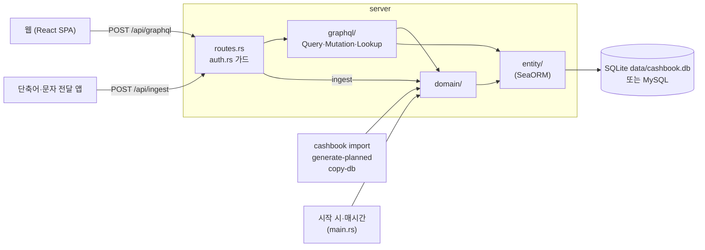
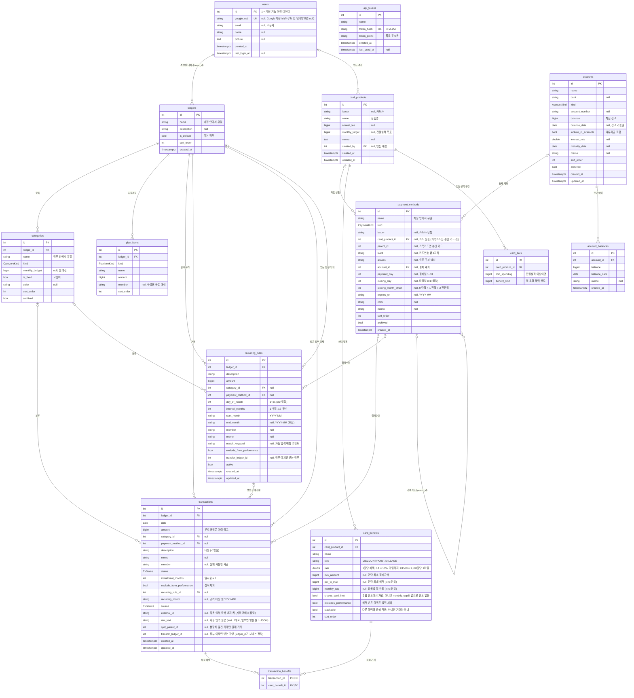

# cashbook server

가계부 백엔드. Rust 2024 · Rocket 0.5 · async-graphql 7 · SeaORM 2 · SQLite 또는 MySQL (`DATABASE_URL`).

이 문서는 서버 코드 구조와 데이터 모델을 설명합니다. 다음 내용은 루트 README에 있습니다.

- 실행·데이터 가져오기·운영 명령: [빠른 시작](../README.md#빠른-시작)
- 환경 변수·보안 동작: [설정](../README.md#설정-환경-변수)
- 소비·정산·여유자금·혜택 계산 규칙: [핵심 계산 규칙](../README.md#핵심-계산-규칙)
- `/api/ingest` 요청 형식: [자동 입력 API](../README.md#자동-입력-api)
- 테스트 실행: [테스트](../README.md#테스트)

## 디렉터리 구조

```text
server/
├── Cargo.toml              패키지 cashbook-server, 바이너리 cashbook
├── Rocket.toml             주소·포트, JSON/GraphQL 요청 크기 제한
├── .env.example            환경 변수 예시 (.env로 복사)
├── data/                   실행 시 생성: cashbook.db, secret.key (git 제외)
└── src/
    ├── main.rs             CLI 분기(serve / import / generate-planned), Rocket 기동, 매시간 예정 거래 작업
    ├── config.rs           AppConfig: 환경 변수, "오늘"(CASHBOOK_TZ 기준)
    ├── auth.rs             계정 세션·API 토큰, Auth 가드(계정 id·관리자), Origin·Host 검사
    ├── oauth.rs            Google 로그인: Authorization Code + PKCE, 코드 교환·userinfo
    ├── routes.rs           REST 라우트(세션·Google 로그인·자동 입력), /api 오류 catcher(JSON), SPA 서빙
    ├── db/
    │   ├── mod.rs          연결 + 마이그레이션 자동 적용, SQLite·MySQL 차이를 감추는 SQL 조각(sql), 테스트용 인메모리 DB
    │   ├── migration.rs    손으로 쓴 마이그레이션
    │   └── copy.rs         copy-db: DB 사이 데이터 복사 (SQLite ↔ MySQL)
    ├── entity/             테이블당 SeaORM 엔티티 하나 (대부분 GraphQL 타입 겸용)
    │   ├── mod.rs          계정별 테이블의 범위(UserOwned·OfUser), user_id 없는 저장 거절(user_owned!)
    │   ├── enums.rs        문자열로 저장하는 enum (DeriveActiveEnum + graphql Enum)
    │   └── *.rs            user, ledger, category, plan_item, payment_method, card_product, card_benefit, card_tier,
    │                       account, account_balance, transaction, transaction_benefit,
    │                       recurring_rule, recurring_rule_benefit, api_token
    ├── domain/             GraphQL과 분리된 계산·처리 (단위 테스트 포함)
    │   ├── dates.rs        "YYYY-MM" 월 계산 도우미
    │   ├── billing.rs      카드 정산 주기, 결제일 주말 보정, 할부 분할
    │   ├── benefits.rs     전월실적·혜택 (건별 → 항목 월한도 → 통합한도 날짜순 누적)
    │   ├── card_report.rs  카드별 이번 달 실적·혜택 잔여·다음 구간
    │   ├── summary.rs      월 요약 (소비·월잔액·평균·장부 이체), outflow()
    │   ├── funds.rs        여유자금 (잔고 − 미반영 카드대금·출금)
    │   ├── recurring.rs    반복 규칙 → 예정 거래 (ensure_planned)
    │   ├── sms.rs          카드 승인 문자 파서
    │   ├── ingest.rs       자동 입력 (중복 방지 → 결제수단 해석 → 분류 추천 → 예정 매칭)
    │   ├── split.rs        거래 분할 (한 결제를 두 장부에)
    │   ├── legacy_plan.rs  예전 지출계획(월 수입·배분)을 정기수익·장부 이체 반복으로 옮기는 규칙
    │   ├── users.rs        Google 로그인 계정 찾기·만들기 (소유자 이메일은 기존 데이터 계정을 넘겨받음, 새 계정 기본 장부)
    │   └── import.rs       정규화 JSON 가져오기 (계정 하나에)
    └── graphql/            도메인별 Query / Mutation → MergedObject
        ├── mod.rs          스키마 빌드, 요청 계정(CurrentUser)·요청 단위 캐시 Lookup, 공용 도우미, 계정 격리 테스트
        ├── ledger.rs       장부·카테고리·지출계획 항목·구성원
        ├── payment.rs      결제수단(카드)·청구서·실적 리포트 (혜택·구간은 카드 상품 것)
        ├── card_product.rs 카드 상품(전월실적 목표·구간·혜택·연회비, 모든 계정 공용)
        ├── account.rs      계좌·잔고·여유자금
        ├── transaction.rs  거래, 확정/건너뛰기/복원, 자동 입력, 추천
        ├── recurring.rs    반복 규칙 (지출·수입·장부 이체)
        ├── summary.rs      월 요약·앱 정보
        └── token.rs        API 토큰 발급/폐기
```

## 계층



- 의존 방향은 `routes → graphql → domain → entity` 한쪽입니다. `domain/`은 `graphql/`을 참조하지 않으므로 CLI·REST·GraphQL이 같은 함수를 씁니다.
- 단순 CRUD는 `graphql/*.rs`에서 엔티티를 직접 다루고, 계산이나 여러 테이블에 걸친 처리는 `domain/`에 둡니다.

### GraphQL 요청

1. `POST /api/graphql`: `Auth` 가드를 통과해야 합니다 (로그인 세션 또는 API 토큰). 가드가 정한 계정을 `CurrentUser`(계정 id·관리자)로 `request.data`에 넣습니다.
2. 요청마다 그 계정의 `Lookup::new(db, user_id)`를 넣습니다. 장부·카테고리·결제수단·계좌·거래-혜택처럼 작은 테이블은 그 계정 것만, 카드 상품·혜택·구간은 공용이라 전부, 요청당 한 번만 읽어서 거래 목록의 하위 필드(`category`, `paymentMethod`, `benefits` …)가 N+1 쿼리를 내지 않게 합니다.
3. 리졸버는 `uid(ctx)`(계정 id), `db(ctx)`, `config(ctx)`, `lookup(ctx)`로 꺼내 쓰고, 계정별 테이블은 항상 `.of_user(uid)`로 범위를 겁니다(모델의 하위 필드는 `self.user_id`). 뮤테이션 후에는 `lookup(ctx).invalidate()`를 호출합니다.
4. 입력 오류는 `user_error()`로 `code: BAD_USER_INPUT`을 붙여 돌려줍니다.

| 파일 | Query | Mutation | 타입의 계산 필드 (`#[ComplexObject]`) |
|---|---|---|---|
| `ledger.rs` | `ledgers` `categories(ledgerId)` `planItems(ledgerId)` `members` | 장부·카테고리·계획 항목 create/update/delete, `reorderCategories` | — |
| `payment.rs` | `paymentMethods(cardsOnly)` `paymentMethod(id)` `cardsMonthly(month)` `statementLines(paymentMethodId, month)` `suggestedBilling(paymentDay)` | create/update/delete/`restorePaymentMethod` (카드 상품은 `cardProductId`로 고름), `reorderPaymentMethods` | `PaymentMethod`: `aliases` `isCard` `billingConfigured` `usagePeriodLabel` `account` `cardProduct` `productName` `monthlyTarget` `annualFee` `benefits` `tiers`(뒤의 다섯은 카드 상품 값) `transactionCount` `lastUsedOn` `statements` `nextPayment` `monthReport(month)` |
| `card_product.rs` | `cardProducts(search)` `cardProduct(id)` | create/update/`deleteCardProduct` (혜택·구간 포함, 고치기·지우기는 만든 계정·관리자) | `CardProduct`: `label` `benefits` `tiers` `canEdit` `createdByMe` `cardCount` |
| `account.rs` | `accounts` `account(id)` `availableFunds` | create/update/`deleteAccount`, `updateAccountBalance` `deleteAccountBalance` `reorderAccounts` | `Account`: `history` `paymentMethods` |
| `transaction.rs` | `transactions(filter, sort)` (장부 필터는 받은 이체 포함, `transfers` 필터, 이체 합계 별도) `transaction(id)` `descriptionSuggestions(query)` `suggestCategory(description)` `parseMessage(text)` | create/update/`deleteTransaction`, `deleteTransactions`(일괄, 한 트랜잭션), `createTransactions`(일괄), `confirm`/`skip`/`restoreTransaction`, `ingestTransaction` | `Transaction`: `ledger` `category` `paymentMethod` `benefitIds` `benefits` `isIncome` `statementMonth` `paymentDate` |
| `recurring.rs` | `recurringRules(ledgerId)` (그 장부로 보내는 이체 규칙 포함) | create/update/`deleteRecurringRule`, `generatePlanned` | `RecurringRule`: `category` `paymentMethod` `nextDate` |
| `summary.rs` | `monthlySummary(month, ledgerId, averageMonths, historyMonths)` `appInfo` | — | — |
| `token.rs` | `apiTokens` | `createApiToken` `deleteApiToken` | — |

### 자동 입력 요청

`routes.rs`의 `ingest_json`/`ingest_text`가 `Auth` 가드(API 토큰 또는 세션)를 통과하면 건마다 DB 트랜잭션을 열고 `domain::ingest::ingest()`를 실행한 뒤, 카테고리·결제수단 이름까지 풀어서 JSON으로 응답합니다. GraphQL `ingestTransaction`도 같은 `domain::ingest`를 씁니다.

### 인증 가드 (`auth.rs`)

`Auth`는 아래 순서로 판정하고 계정 id와 관리자 여부를 돌려줍니다. GraphQL과 자동 입력이 같은 가드를 쓰고, 토큰에는 권한 구분이 없습니다.

1. `Origin`이 `Host`(또는 `X-Forwarded-Host`, `CASHBOOK_ALLOWED_ORIGINS`)와 다르면 403
2. Google 로그인을 설정하지 않았으면 localhost Host(+ `CASHBOOK_ALLOWED_HOSTS`)일 때만 계정 id 1(관리자), 아니면 403
3. `Authorization: Bearer` / `X-Api-Key` 토큰이 있으면 SHA-256 해시로 조회 → 토큰 주인 계정 또는 401
4. 암호화 세션 쿠키(`v2:계정id:로그인 시각`, 30일)의 계정이 있으면 그 계정, 아니면 401
5. 관리자: 계정 이메일이 `CASHBOOK_ADMIN_EMAILS` 또는 `CASHBOOK_OWNER_EMAIL`

### Google 로그인 (`oauth.rs`, `domain/users.rs`)

1. `GET /api/auth/google?next=/경로` — state·PKCE 검증값·돌아갈 경로를 10분짜리 암호화 쿠키(`cashbook_oauth`, SameSite=Lax, path `/api/auth`)에 넣고 Google 로그인 화면으로 보냅니다.
2. `GET /api/auth/google/callback?code&state` — 쿠키의 state와 맞는지 확인하고, 코드를 토큰으로 바꿔(`code_verifier` 포함) userinfo(sub·이메일·이름·사진)를 받습니다.
3. `users::login_google`: 같은 Google 계정(`sub`) → 이메일이 `CASHBOOK_OWNER_EMAIL`이고 계정 id 1을 아무도 넘겨받지 않았으면 그 계정 → 아니면 새 계정과 기본 장부(가계부)·항목. 이메일이 확인되지 않은 계정은 가입하지 못합니다.
4. 세션 쿠키를 만들고 `next`(이 사이트 안의 경로만)로 보냅니다. 실패하면 `/login?error=이유`.

시험은 `routes.rs`의 가짜 Google 서버(토큰·userinfo를 흉내 내는 TCP 서버)로 전체 흐름을 돌립니다.

403 사유는 `ForbiddenReason`으로 요청 로컬 캐시에 남기고, `/api` catcher가 `{"ok": false, "error": "..."}`로 돌려줍니다.

### 백그라운드 작업

예정 거래 생성은 `recurring::ensure_planned()` 하나로, `main.rs`에서 서버 시작 시·매시간(`tokio::spawn`)·`import`와 `generate-planned` 명령 뒤에 호출합니다.

## 데이터베이스

### ERD

타입은 마이그레이션 기준입니다 (`bigint` = 원 단위 금액 `i64`, `timestamptz` = `DateTimeUtc`). enum 타입 컬럼은 DB에 문자열로 저장됩니다. 주석의 `null`은 NULL 허용 컬럼입니다.

계정별 테이블(`ledgers`, `categories`, `plan_items`, `accounts`, `payment_methods`, `recurring_rules`, `transactions`, `api_tokens`)에는 모두
`int user_id FK`(users, 기본값 0이라 빠뜨리면 외래 키 오류)가 있어 아래 그림에서는 줄였습니다. `card_products`·`card_benefits`·`card_tiers`는 모든 계정 공용입니다.



`api_tokens`는 계정(`user_id`) 말고는 다른 테이블과 관계가 없습니다.

### 외래 키 삭제 동작

모든 외래 키는 `ON UPDATE CASCADE`입니다.

| 컬럼 | 참조 | ON DELETE |
|---|---|---|
| 계정별 테이블의 `user_id` | `users` | CASCADE (계정을 지우면 그 계정 데이터도) |
| `card_products.created_by` | `users` | SET NULL (그 뒤로는 관리자만 고침) |
| `payment_methods.card_product_id` | `card_products` | SET NULL (앱은 고른 카드가 있는 상품을 지우지 않음) |
| `categories.ledger_id`, `plan_items.ledger_id`, `recurring_rules.ledger_id` | `ledgers` | CASCADE |
| `transactions.ledger_id` | `ledgers` | **RESTRICT** (거래가 있는 장부는 지울 수 없음) |
| `transactions.category_id`, `recurring_rules.category_id` | `categories` | SET NULL |
| `transactions.payment_method_id`, `recurring_rules.payment_method_id` | `payment_methods` | SET NULL |
| `transactions.recurring_rule_id` | `recurring_rules` | SET NULL |
| `transactions.split_parent_id`, `transactions.transfer_ledger_id`, `recurring_rules.transfer_ledger_id` | `transactions` / `ledgers` | (외래 키 없음, 인덱스만 — SQLite는 ALTER TABLE로 외래 키를 붙일 수 없음. 장부 삭제는 받은 이체·이체 규칙이 있으면 앱이 거절) |
| `card_benefits.card_product_id`, `card_tiers.card_product_id` | `card_products` | CASCADE (혜택을 지우면 모든 계정의 거래·반복 규칙 혜택 지정도) |
| `payment_methods.account_id` | `accounts` | SET NULL |
| `account_balances.account_id` | `accounts` | CASCADE |
| `transaction_benefits.transaction_id` / `.card_benefit_id` | `transactions` / `card_benefits` | CASCADE |

앱은 거래가 연결된 카테고리·결제수단을 지우지 않고 `archived`로 보관하므로, SET NULL은 주로 연결 거래가 없는 항목을 지울 때만 일어납니다.

### 유일 제약·인덱스

| 이름 | 컬럼 | 용도 |
|---|---|---|
| (컬럼 UNIQUE) | `api_tokens.token_hash` | 토큰 조회 |
| `uq_users_google_sub` | `users (google_sub)` | Google 계정 하나에 계정 하나 |
| `uq_ledgers_user_name`, `uq_payment_methods_user_name` | `(user_id, name)` | 계정 안 장부·결제수단 이름 중복 방지 |
| `ix_*_user` | `categories`·`plan_items`·`accounts`·`recurring_rules`·`api_tokens (user_id)`, `transactions (user_id, date)` | 계정별 조회 |
| `uq_categories_ledger_name` | `categories (ledger_id, name)` | 장부 안 카테고리 이름 중복 방지 |
| `uq_transactions_recurring_occurrence` | `transactions (recurring_rule_id, recurring_month)` | 규칙 하나당 한 달에 한 건. 일반 거래는 둘 다 NULL이라 영향 없음 |
| `uq_transactions_user_external` | `transactions (user_id, external_id)` | 자동 입력 중복 방지 (계정마다) |
| `ix_card_*_product`, `ix_payment_methods_card_product` | `card_benefits`·`card_tiers`·`payment_methods (card_product_id)` | 상품별 혜택·구간·사용 카드 |
| `ix_transactions_*` | `(date)`, `(ledger_id, date)`, `(payment_method_id, date)`, `(status, date)`, `(description)`, `(split_parent_id)`, `(transfer_ledger_id, date)` | 월별·카드별·상태별 조회, 가맹점 자동완성, 분할 묶음, 받은 이체 |
| `ix_account_balances_account_date` | `account_balances (account_id, balance_date)` | 잔고 이력 |
| `ix_transaction_benefits_card_benefit` | `transaction_benefits (card_benefit_id)` | 혜택별 거래 조회 |

### enum 값

`entity/enums.rs`. DB에는 아래 문자열 그대로, GraphQL에는 같은 이름의 enum으로 나갑니다.

| enum | 컬럼 | 값 |
|---|---|---|
| `CategoryKind` | `categories.kind` | `EXPENSE`, `INCOME` |
| `PaymentKind` | `payment_methods.kind` | `CREDIT_CARD`, `CHECK_CARD`, `CASH`, `BANK_TRANSFER`, `OTHER` |
| `AccountKind` | `accounts.kind` | `CHECKING`, `SAVINGS`, `DEPOSIT`, `INVESTMENT`, `CASH`, `OTHER` |
| `TxStatus` | `transactions.status` | `CONFIRMED`, `PLANNED`, `SKIPPED` |
| `TxSource` | `transactions.source` | `MANUAL`, `IMPORT`, `API`, `RECURRING` |
| `PlanItemKind` | `plan_items.kind` | `ALLOCATION`, `MEMBER_ALLOWANCE` (예전 `INCOME`은 정기수익 반복 규칙으로 옮겨 없음) |

### 스키마에 드러나지 않는 규칙

- **금액 부호**: 원 단위 `i64`. 지출 카테고리는 양수=지출·음수=환불, 수입 카테고리는 양수=수입. 카드 청구·결제수단 합계는 `summary::outflow()`(수입이면 부호 반전)로 계산합니다.
- **장부 이체**: `transfer_ledger_id`가 있는 거래 한 행이 `ledger_id` 장부에서 그 장부로 금액을 옮깁니다(항목·결제수단·할부·혜택 없음). 장부를 정한 요약·목록에서는 보낸 이체/받은 이체로 따로 모으고, 소비·수입 합계·카드·여유자금에는 넣지 않습니다(`summary::classify`, `outflow()`는 0). 전체 장부 합계에서는 장부 사이에서만 오가는 돈이라 뺍니다. 반복 규칙의 `transfer_ledger_id`가 그대로 예정 이체에 들어갑니다. 이체는 분할할 수 없고, 받는 장부로 옮길 수 없습니다.
- **SeaORM Relation 미사용**: 엔티티의 `Relation` enum은 비어 있고 외래 키는 마이그레이션에만 있습니다. 연관 데이터는 `Lookup` 캐시나 명시적인 쿼리로 가져옵니다.
- **예정 거래**: 예정(`PLANNED`)도 `transactions`에 함께 둡니다. 삭제한 반복 항목을 `SKIPPED`로 남기는 규칙([지출 예정](../README.md#지출-예정))은 `(recurring_rule_id, recurring_month)` 유니크 자리를 지키기 위한 것입니다. 행을 지워 자리를 비우면 `ensure_planned`가 다시 만듭니다.
- **할부**: 거래는 한 행으로 저장하고, 청구서별 회차 분할은 `billing.rs`가 계산 시점에 합니다.
- **잔고**: `accounts.balance`/`balance_date`가 최신 값이고, 기록할 때마다 `account_balances`에 이력이 쌓입니다.
- **GraphQL에 숨기는 컬럼**: `api_tokens.token_hash`, `transactions.external_id`, `payment_methods.aliases`(대신 `aliases` 목록 필드). `transaction_benefits`는 GraphQL 타입이 아니고 `Transaction.benefitIds`/`benefits`로 노출합니다.

### 마이그레이션

`db/migration.rs`에 손으로 쓰고, 서버·CLI가 DB에 연결할 때 자동 적용됩니다.

| 이름 | 내용 |
|---|---|
| `m20261023_000001_init` | 전체 테이블·외래 키·인덱스 |
| `m20261023_000002_api_token_scope` | `api_tokens.scope` 추가 (기존 토큰은 `INGEST`) |
| `m20261102_000003_card_benefit_kind_stackable` | `card_benefits.kind`(기본 `DISCOUNT`)·`stackable`(기본 false) 추가 |
| `m20261109_000004_mysql_text_columns` | MySQL에서만: 긴 글 컬럼(`raw_text`, 각 `memo`, `aliases`, `match_keyword`, `ledgers.description`)을 varchar(255) → TEXT. SQLite는 기록만 |
| `m20261119_000005_transaction_split` | `transactions.split_parent_id` + 인덱스 |
| `m20261120_000006_ledger_transfers` | `transactions.transfer_ledger_id`(+ `(transfer_ledger_id, date)` 인덱스), `recurring_rules.transfer_ledger_id` |
| `m20261120_000007_convert_legacy_plan` | 데이터만, 한 트랜잭션: 합계 제외 카테고리 → 같은 이름 장부로(거래·반복 규칙째), 월 수입 계획 → 정기수익 항목 매월 10일 반복 수입, 장부와 이름이 맞는 배분 → 매월 1일 장부 이체 반복(이번 달부터), 이체가 대신하는 받는 장부의 월 수입 삭제. 규칙은 `domain::legacy_plan`, 가져오기도 같은 규칙 |
| `m20261120_000008_drop_excluded_from_spending` | `categories.excluded_from_spending` 삭제 |
| `m20261122_000011_drop_api_token_scope` | `api_tokens.scope` 삭제: 토큰 권한을 하나로 합쳐 예전 자동 입력 전용(`INGEST`) 토큰도 GraphQL을 쓴다 |

스키마를 바꿀 때:

1. 기존 마이그레이션은 고치지 않고 `migration.rs`에 새 모듈을 추가해 `Migrator::migrations()`에 등록합니다.
2. `entity/`의 모델을 맞춥니다. 타입 매핑: `i64`→`big_integer`, `NaiveDate`→`date`, `DateTimeUtc`→`timestamp_with_time_zone`, `Option<T>`→`*_null`.
3. 이 문서의 ERD를 갱신합니다.
4. SQLite와 MySQL에서 모두 동작해야 합니다. `string()`은 MySQL에서 varchar(255)라 긴 글은 `text`/`text_null`로 만들고,
   인덱스가 걸린 문자열 컬럼만 `string`으로 둡니다. 컬럼 하나씩 `alter_table`합니다(SQLite 제약).

쿼리를 쓸 때:

- `Expr::cust`로 직접 쓰는 SQL은 두 DB에 모두 있는 함수(`instr`, `coalesce`, `count`, `max`)만 쓰고, 다른 것은 `db::sql`을 씁니다
  (`char_length`: MySQL `LENGTH`는 바이트 수, `sum_i64`: MySQL `SUM(BIGINT)`은 DECIMAL이라 i64로 읽으려면 CAST).
- `ORDER BY` 없는 결과 순서는 DB마다 다릅니다(SQLite 입력순, MySQL 기본 키순). 화면이나 계산에 순서가 드러나면 정렬을 명시하고, `LIMIT` 앞의 정렬은 동점까지 정합니다.

## 테스트

단위 테스트는 각 모듈 안 `#[cfg(test)] mod tests`에 있고 대부분 `domain/`과 `auth.rs`에 있습니다. DB가 필요한 테스트는 `db::connect_in_memory()`로 마이그레이션까지 적용된 인메모리 SQLite를 씁니다 (커넥션 풀 1개 고정). 실행 방법과 브라우저 E2E는 [루트 README](../README.md#테스트)를 보세요.
